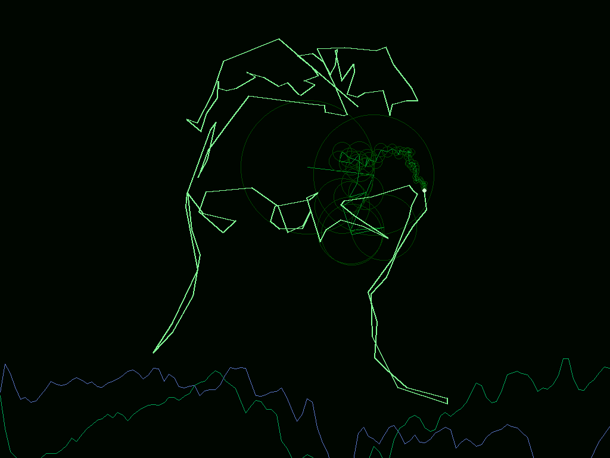

# AgentZero

**A from-scratch, OS-less x86 kernel that an AI agent drives at ring 0 — over the network.**

AgentZero turns a bare PC into a headless agent terminal: it boots with no operating
system, enumerates its own hardware, and listens for one-letter *hardware instructions*
over UDP. An agent on another machine sends a command, the kernel executes it directly on
the metal (CPUID, PCI config, port I/O, physical memory, RTC, gated port writes) and sends
the result back — with a Matrix-style green binary-rain UI on the screen for good measure.

No operating system. No NIC driver (it borrows the firmware's PXE UDP stack). No serial
cable. Just the CPU, the chipset, and the agent.


> *Above: AgentZero booted over the network on a 2009 Asus K50IJ laptop — PCI self-scan,
> banner, and the ambient binary rain, all in ring 0 with no OS.*

---

## Why

It started with an old Asus K50IJ that could no longer boot its Linux (antiX) reliably —
it kept hanging while the kernel probed the SATA/AHCI controller. The bet: a tiny
self-written kernel that **never touches the disk** might boot where the full OS stalls,
and could serve as an unattended, agent-controlled hardware terminal.

The bet paid off. AgentZero boots the old laptop fine (it enumerates the SATA controller
in PCI space but never initializes it), and an agent now drives it live over the LAN.

## Features

- **32-bit protected mode**, flat 4 GiB segments, ring 0, no interrupts (polled).
- **Self-scanning**: on boot it enumerates PCI (mechanism 1) and prints every device as
  `bus:dev.fn vendor:device class` — the kernel tells you what hardware it's on.
- **The AgentZero ISA** — a compact hardware instruction set (see below).
- **Two control channels**:
  - **Serial** (COM1) for development under QEMU.
  - **Network (UDP)** on real hardware, via the resident **PXE UDP API** — no NIC driver.
- **PXE network boot** — iterate without ever re-flashing a USB stick: rebuild, and the
  machine pulls the new kernel on its next network boot.
- **USB / raw-disk boot** too (LBA with CHS fallback).
- **Matrix UI**: a binary digital-rain intro and an ambient rain behind the terminal;
  each command is echoed as 8-bit binary before it runs.

 

## The AgentZero ISA

Each command is one line; the reply ends with CRLF.

| Cmd | Form | Does |
|-----|------|------|
| `C` | `C` | CPUID leaf 0 vendor string (e.g. `GenuineIntel`) |
| `F` | `F` | CPUID leaf 1 EAX (family/model/stepping) |
| `I` | `I<4hex port>` | `inb` from an I/O port → `=XX` |
| `T` | `T` | RTC time from CMOS (ports 70/71), `HH:MM:SS` BCD |
| `M` | `M<8hex addr><2hex len>` | read linear memory, hex dump (flat 4 GiB) |
| `P` | `P<2hex bus><2hex dev><1hex fn><2hex off>` | PCI config dword (0xCF8/0xCFC) |
| `O` | `O<4hex port><2hex val>!` | **gated** `outb` — the trailing `!` confirm byte is required |
| `?` | `?` | list commands |

`O` is the only write. Everything else is read-only probing; the mandatory `!` confirm
byte keeps an agent from firing a dangerous port write by accident.

The agent also drives the screen directly with display commands (no reply):

| Cmd | Form | Does |
|-----|------|------|
| `X` / `R` | `X` / `R` | clear the screen / resume ambient rain |
| `D` | `D<text>` | write a line |
| `S` | `S<2hex row><2hex col><text>` | write text at (row, col), idempotent |
| `B` | `B<2hex startrow>⏎<lines>` | block write: each line at (startrow + i, 0) |

## The agent chat terminal

Beyond one-letter probes, AgentZero runs as a full **network chat terminal** — the machine
becomes the agent's face and keyboard, with no OS underneath:

- It boots into a **portrait avatar** rendered as ASCII (baked into the kernel as
  `face_data.inc`, rendered from a photo by `gen_facedata.py`) on the right, after a Matrix
  rain intro that zooms and condenses into the face.
- You **type a question on the machine's own keyboard** — a from-scratch PS/2 8042 driver
  (German QWERTZ map, hardware text cursor). Keystrokes leave the box as raw UDP.
- A service on the dev PC answers and sends the text back; the kernel paints it on the
  **left** while the face stays on the right.

```bash
python agent_chat.py     # dev PC: answers questions on UDP 50001, replies to :50000
```

Answers come from **Claude** (the Anthropic API) in character and sized for the 40-column
screen, with a graceful fall-back to canned replies when no key is set. Put the key in
`ANTHROPIC_API_KEY` or a gitignored `api_key.txt` (org-scoped keys also need
`ANTHROPIC_WORKSPACE_ID` / `workspace_id.txt`).

It also has a **bare-metal web reader**. Type `web <domain>` on the machine's own keyboard
(e.g. `web en.wikipedia.org/wiki/albert_einstein`, lowercase, so no Shift keys are needed) and
the dev PC fetches the page, pulls out the title, text, images and links, lays them out as
clean reader pages (not a screenshot — a reflowed view with the real images), and streams them
to the laptop's framebuffer. Then you navigate it entirely from the machine's own keyboard:

| Key | Does |
|-----|------|
| `j` / `k` | move the link cursor (a red ▶) down / up, auto-paging to the links |
| `space` / `f` | follow the selected link (loads that page) |
| `n` / `p` | next / previous page |
| `q` | back to the face |

Keys act *per-keystroke* (the kernel sends each key as it is pressed while a page is shown, not
line-buffered), so it feels like a real browser. Dev-PC pieces: `webread.py` (parse + lay out),
`show_image.py` (RLE framebuffer blits — a reader page is mostly flat colour, so it compresses
to a few hundred packets and lands in ~2 s), and `agent_chat.py` routes the keys. For a raw
full-page screenshot instead, `shot <domain>` (via `webshot.py` + headless Chrome). The older
text-digest browser, `web.py`, boils a page down to a Claude summary.

**Talking face**: the dev PC reads each answer aloud through Windows SAPI (an English voice),
and while it speaks, `face_anim.py` flaps the ASCII portrait's mouth on the screen with
positioned `S` writes - so the face has a voice *and* moves its mouth, then closes it when
done. All driven over UDP, no kernel change. Mute the voice with `AGENTZERO_TTS=0`; tune the
mouth with `MOUTH_ROWS` / `MOUTH_C0` / `MOUTH_C1`.

Three real-hardware gotchas, all fixed here:

- **The BIOS steals your keystrokes.** Polling the 8042 from protected mode drops keys: the
  PXE UDP calls briefly return to real mode with interrupts on, and the real-mode BIOS
  INT 09h handler reads port 0x60 first. Fix — disable the keyboard IRQ1 (8042 command-byte
  bit 0) and mask IRQ1 at the PIC, so scancodes wait in the output buffer for the poll.
- **`PXENV_UDP_WRITE` sends nowhere with `gw = 0`** on this old UNDI stack, even on-subnet.
  Fix — set the gateway field to the destination IP.
- **Windows kills the UDP service on reply.** `sendto` to a port with no listener returns an
  ICMP port-unreachable that makes the *next* `recvfrom` raise `WinError 10054`. Fix — ignore
  it and keep serving.

## A graphics console

The chat terminal doesn't use VGA text mode — it runs as a **graphics console**. Right after
the (unchanged) text-mode boot animation, the kernel switches into a **VBE linear-framebuffer
mode** (it scans the VBE mode list for a 32-bpp LFB mode, preferring 1024×768) *once*, in real
mode, where the old hardware actually honours it. From then on the display never changes mode:

- The existing text code still writes `char + attr` cells, but to a **RAM shadow buffer**, and
  a software renderer (`present_text`) paints that buffer into the framebuffer using the BIOS
  **8×8 ROM font** (grabbed at boot via INT 10h `AX=1130`). The face and dialogue you see are
  pixels, drawn glyph by glyph.
- **Images blit straight in.** The dev PC does the heavy lifting (decode, scale, BGRX), and the
  kernel just copies pixel bytes into the framebuffer. So `web <domain>` paints the real page
  full-screen over the console; type anything and it repaints the face.

Why a console instead of switching modes on demand? This 2009 GMA won't set a VBE mode at
*runtime* (from protected mode, after the PXE stack is up) — only the boot-time switch sticks.
Rendering everything as pixels in one mode sidesteps that and is rock-solid on the real laptop.

UDP commands added for the console:

| Cmd | Form | Does |
|-----|------|------|
| `G` | `G<8hex LFB byte offset><raw pixel bytes>` | blit pixels into the framebuffer (shows an image) |
| `U` | `U` | drop the image, repaint the text/face console |
| `Q` | `Q` | reply 16 bytes: framebuffer `width height pitch bpp` (little-endian) |

```bash
python show_image.py photo.jpg 192.168.x.z       # stream any photo to the laptop
python webshot.py example.com shot.png           # screenshot a page (headless Chrome)
```

A separate `IMAGE_DEMO=1 bash build.sh` builds a minimal kernel that boots *straight* into the
framebuffer (no face/chat) for a pure full-screen photo demo.


> *The OS-less laptop in a 1024×768×32 VBE graphics mode, drawn pixel-by-pixel into the linear
> framebuffer. A full-screen photo streams in the same way — `show_image.py` lays it out at the
> exact pitch and sends it over UDP. Verified end to end in QEMU and on the real Asus K50IJ.*

`show_image.py` asks for the geometry with `Q` (falling back to 1024×768×32), scales to fit
(`--cover` / `--fit` / `--stretch`), and sends a couple of idempotent passes to ride out
dropped packets. Graphics mode replaces the text console, so the image kernel is a separate
build from the chat terminal above.

## The old PC computes: a Fourier portrait

The kernel doesn't just *show* things — its CPU *computes*. Three ring-0 commands turn
the OS-less laptop into a compute unit an agent drives over UDP:

| Cmd | Form | Does |
|-----|------|------|
| `A` | `A<op><8hex a><8hex b>` | the CPU evaluates a math problem (`+ - *`, gcd, sum, factorial) and returns the answer |
| `L` | `L<8hex addr><raw bytes>` | bulk-load bytes into a scratch RAM window `[0x100000,0x180000)` (bounded, can't touch MMIO) |
| `E` | `E<4hex t>` | evaluate a preloaded **Fourier series** (epicycle chain) in integer fixed point, return the chain points |

The showcase is a **Fourier "epicycle" portrait of Dario**. The brain (`organism/fourier.py`)
turns a photo into a single contour, DFTs it into rotating vectors, and quantises them to
fixed-point coefficients plus an integer sine table. Those are `L`-loaded into the laptop's
RAM; then **each frame the laptop's own CPU evaluates the Fourier series** (`E`) and returns
the turning-wheel centres and the pen tip. The dev side only turns those numbers into pixels —
the wheels, the arms, the growing pen trace (Dario's outline) and the X/Y waveforms — and blits
the frame to the framebuffer. The maths runs on the old PC; verified bit-for-bit against a
reference evaluator (`maxdiff = 0`), 0 dropped replies over a 120-frame run.



> *Drawn on the bare-metal laptop by 64 rotating vectors. Each frame's epicycle positions are
> computed by the laptop's own CPU in integer fixed point (`E` command); the dev PC only renders
> the returned points. Green pen trace = the portrait outline, nested circles = the turning
> wheels, bottom = the real/imaginary waveforms the epicycles synthesise.*

This lives in `organism/` — the self-organising "cell" structure (see `organism/GENOME.md`):
`hw.py` is the only hardware interface, `skills/` holds replayable operations
(`cpu_math_answer.py`, `fourier_dario.py`), and `knowledge/` holds what each cell learned
(`cpu-alu.md`, `fourier-epicycles.md`).

## Build

Needs [NASM](https://www.nasm.us/). Point to it with `NASM=` or have `nasm` on `PATH`:

```bash
NASM=/path/to/nasm bash build.sh            # text face/chat kernel (default)
IMAGE_DEMO=1 NASM=/path/to/nasm bash build.sh   # VBE graphics (image) kernel
```

Produces `disk.img` (USB / raw disk) and `pxe.img` (PXE network boot).

## Run in QEMU

Set `QEMU` to your `qemu-system-i386` (or have it on `PATH`), then:

```bash
# serial REPL (dev)
python agent_repl.py C F I0064 T P0000000 "O0080AB!" "?"

# network boot + UDP command channel, end to end
python pxe_udp_test.py 8 C F P0000000

# grab a screenshot of the self-scan / Matrix screen
python scan_shot.py shot.png
```

## Network boot a real machine (no more USB flashing)

1. Enable the NIC's PXE boot ROM in the BIOS (on the Asus: *Boot → Onboard LAN Boot ROM →
   Enabled*).
2. On your dev PC, run the tiny proxyDHCP + TFTP server (it doesn't hand out IPs — your
   router keeps doing that — it only tells PXE clients where to fetch `pxe.img`):

   ```bash
   python pxe_server.py 192.168.x.y      # your dev PC's LAN IP
   ```
   Allow inbound UDP 67/68/69/4011 through the firewall.
3. Boot the target, pick **Network** (F8 / F12). It pulls `pxe.img` over TFTP and runs it.
4. Drive it over UDP (the kernel listens on port 50000):

   ```bash
   python udp_agent.py 192.168.x.z C F P0000000 M00007DFC04 "?"
   ```

To iterate: edit, `bash build.sh`, network-boot again. The USB stick never comes out.

## USB boot

Write `disk.img` raw to a USB stick (e.g. with `dd`, Rufus in DD mode, or `burn_usb.ps1`
on Windows — it has safety gates and asks for the disk number), set the BIOS to boot it in
Legacy/CSM mode, and go.

## How it works

- **stage1.asm** — 512-byte boot sector; loads stage2 via INT 13h (LBA, CHS fallback).
- **pxe_stage1.asm** — PXE variant; the firmware loads the whole image to 0x7C00, this
  stub relocates stage2 to 0x8000 so the *same* `stage2.bin` boots from USB or network.
- **stage2.asm** — the kernel: enables A20, builds a flat GDT, enters 32-bit protected
  mode, self-scans PCI, and runs the command loop (serial REPL, or the UDP net loop on a
  PXE-booted machine). It calls the PXE UDP API by briefly dropping back to real mode
  (16-bit GDT segment → clear PE → restore the real-mode IVT → far-call the PXENV+ entry →
  back to PM). Timing uses the free-running PIT channel 0, so animations run at the same
  speed in QEMU and on real silicon.

Host-side tooling: `agent_repl.py` (serial), `udp_agent.py` (network), `agent_chat.py`
(the chat answer service), `pxe_server.py` (proxyDHCP+TFTP), `ascii_art.py` /
`gen_facedata.py` (render a photo to the ASCII avatar), `face.py` (push a face over UDP),
`show_image.py` (stream a photo to the framebuffer), `webshot.py` (screenshot a page),
`pxe_qemu_test.py` / `pxe_udp_test.py` / `scan_shot.py` / `matrix_shot.py` /
`kbd_qemu_test.py` / `face_qemu_test.py` (QEMU harnesses), `burn_usb.ps1` (USB writer).

## Status

Proven end to end on real hardware: an agent on a PC driving a bare-metal Asus K50IJ over
the LAN, reading its real chipset live — and now a full chat terminal, where you type a
question on the laptop's own keyboard and the agent answers on its screen, all with no OS.
Display is driven by idempotent positioned/block writes, which fixed the earlier
packet-drop rough edge. Treat this as a working research kernel, not production.

## License

MIT — see [LICENSE](LICENSE).
